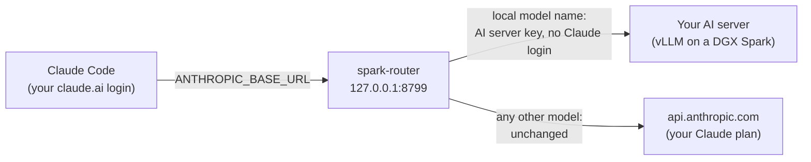

<div align="center">

# Local-Agents-CC

### Run a local model inside Claude Code, next to your Claude plan models.

**Routine work goes to your own AI server (a computer with a GPU that runs your local model). Everything else stays on Claude, with your normal login.**

[](https://www.npmjs.com/package/local-agents-cc)
[](#requirements)
[](package.json)
[](#runs-on-nvidia-dgx-spark)
[](LICENSE)

[Quick start](#quick-start) · [How it works](#how-it-works) · [DGX Spark](#runs-on-nvidia-dgx-spark) · [Configuration](#configuration) · [FAQ](#faq) · [Documentation](#documentation)

<code>npm install -g local-agents-cc</code>

</div>

> [!NOTE]
> Local-Agents-CC is a community project. Anthropic and NVIDIA do not make or support it.

---

Local-Agents-CC lets one Claude Code session use your Claude plan models and a free local model on another computer on your network (your "AI server") at the same time. You keep your normal claude.ai login. Routine, mechanical work can go to the local model. Design, review and hard problems stay on Claude.

It has two commands. The first is `spark-router`, a small router on your computer. A router is a program that sends each request to the right place by its model name. The second is `claude-agents`, a launcher. A launcher is a program that starts the router when needed and opens Claude Code. Only `ANTHROPIC_BASE_URL` changes. Your plan limits and billing stay the same.

## Quick start

### Requirements

- Node.js 22 or later.
- Claude Code, signed in with your claude.ai account.
- A model server program on your AI server that serves the Anthropic Messages API (`POST /v1/messages`), checks a Bearer API key, and answers `GET /health`. vLLM does all three.
- The model must support tool calling: the model asks Claude Code to run a tool, for example to read a file. Claude Code needs this for all of its work. In vLLM, turn it on with `--enable-auto-tool-choice` and the `--tool-call-parser` for your model.
- If your server speaks only the OpenAI API, put a translating proxy in front of it: a program that converts each request and answer between the two API formats, for example LiteLLM. A proxy is not included.

### 1. Install

```bash
npm install -g local-agents-cc
```

### 2. Run the setup

```bash
claude-agents --setup
```

- The AI server is the computer that runs your local model, for example a DGX Spark with vLLM.
- It asks for 3 things:
  - The AI server's address, for example `my-ai-server.local:8000`.
  - The API key: the key that your AI server checks. For vLLM, it is the value of `VLLM_API_KEY` (or `--api-key`) on the AI server. The typing is not shown.
  - The model name. Setup lists the models that your AI server serves, and you pick one.
- It checks that the AI server answers and accepts the key.
- It saves the key in `~/.config/local-model/api-key` (on macOS and Linux, only you can read it) and the address and model name in `~/.config/local-model/settings.json`. On Windows, `~` is `%USERPROFILE%`.
- Run it again at any time to change a value. Press Enter to keep a value.
- To use environment variables instead, see [Configuration](docs/configuration.md).

### 3. Start a session

```bash
claude-agents
```

- On the first start, it runs the router in the background with no window. Then it opens Claude Code. The router keeps running for later sessions until you sign out or restart. If the AI server does not answer, you get a warning and Claude models still work.

### 4. Send work to your AI server

- Whole session: in Claude Code, run `/model`, pick "Spark Agents", and press `s` (this session only).
- Per-task agents: copy the example agent file to `~/.claude/agents/`. If your local model name is not `local-model`, change its `model:` line to that name. Then ask Claude to give a task to `spark-agent`.
- Commands for macOS and Linux:

```bash
cp "$(npm root -g)/local-agents-cc/examples/agents/spark-agent.md" ~/.claude/agents/
```

- Commands for Windows:

```powershell
Copy-Item "$(npm root -g)\local-agents-cc\examples\agents\spark-agent.md" "$HOME\.claude\agents\"
```

- Everything: `claude-agents --all-local` (see below).

## How it works



- For each request, the router reads the `model` field of the JSON body (only `POST /v1/messages` and paths under it, with a JSON content type).
- A name in `SPARK_ROUTER_LOCAL_MODELS` (compared without regard to case) goes to your AI server with the AI server's key as `Authorization: Bearer <key>`. The router first removes the `Authorization`, `x-api-key` and `Cookie` headers that Claude Code sent. Your Claude login never goes to the AI server.
- Every other request goes to `https://api.anthropic.com` unchanged, with your login. The split is per request, by model name. It is not an all-or-nothing switch.
- Some local models accept only `high`, `medium` or `low` reasoning effort. For AI server requests only, the router changes `max` and `xhigh` to `high`. Requests to Anthropic never change.
- If the AI server cannot be reached, the router answers with an Anthropic-style error (HTTP 502). Claude Code shows a clear message.
- More detail: [docs/how-it-works.md](docs/how-it-works.md).

## Runs on NVIDIA DGX Spark

Local-Agents-CC was built for, and runs every day with, an NVIDIA DGX Spark as the AI server.

- The DGX Spark has an NVIDIA GB10 Grace Blackwell chip and 128 GB of memory. The CPU and GPU share this memory. A 120-billion-parameter model fits in this memory.
- Models run this way, served by vLLM: OpenAI gpt-oss-120b and Google Gemma 4 26B-A4B (8-bit). Only one of them fits in memory at a time.
- About 8 agents at the same time work well (about 6 with gpt-oss-120b). More agents queue, and each one gets slower, because they share one GPU.
- gpt-oss-120b has a 131,072-token context window. The launcher's default `CLAUDE_CODE_MAX_CONTEXT_TOKENS` of 120,000 leaves room for the answer.
- gpt-oss-120b accepts only `high`, `medium` or `low` reasoning effort. This is why the router has the effort cap.
- Setup notes and a sample vLLM command: [docs/dgx-spark.md](docs/dgx-spark.md). Any other server that meets the requirements works too.

## Configuration

| Variable | Default | What it does |
|---|---|---|
| (settings file) | - | `claude-agents --setup` writes the address and the model name to `~/.config/local-model/settings.json`. The environment variables below win over it. |
| `SPARK_ROUTER_PORT` | `8799` | Port the router listens on (127.0.0.1 only). |
| `SPARK_ROUTER_LOCAL_MODELS` | `local-model` | Comma-separated model names that go to the AI server. The first name is the one `claude-agents` offers in `/model` and uses for `--all-local`. |
| `SPARK_ROUTER_LOCAL_URL` | `http://your-ai-server.local:8000` | Your AI server's address. |
| `SPARK_ROUTER_KEY_FILE` | `~/.config/local-model/api-key` | File that holds the AI server's API key. |
| `SPARK_ROUTER_LOG_DIR` | per system (see the docs) | Folder for the router's log files. |
| `SPARK_MISSED_EVENTS_FILE` | `missed-tool-events.jsonl` in the log folder | File where the Stop hook of `--all-local` sessions records each missed tool call. |
| `LOCAL_MODEL_CONTINUE` | not set | `off` turns off the Stop hook of `--all-local` sessions. |
| `CLAUDE_CODE_MAX_CONTEXT_TOKENS` | `120000` (set by `claude-agents`) | Context window that Claude Code assumes for the local model. Keep it under the model's real window, with room for the answer. If you set it yourself, the launcher keeps your value. |

All settings, log locations and examples: [docs/configuration.md](docs/configuration.md).

## `--all-local` mode

- `claude-agents --all-local` sends every model (opus, sonnet, haiku, fable), every agent and Claude Code's background jobs to the AI server. No request uses your Claude plan. This helps when you reach your plan limit.
- Web search is off, because it runs on Anthropic's servers.
- Agents cannot start more agents. The load on the AI server stays predictable. Shell commands get a 10-minute limit.
- It stops with an error if the AI server does not answer.
- Everything the session reads goes to the AI server. Keep credentials, connection strings and customer data out of these sessions.
- Small local models sometimes end a reply with a plan but no tool call (for example "I will now write the file"). Claude Code then ends the turn, and the work stops. In `--all-local` sessions, a Stop hook sends the model back once to make the call.
- Each time, the hook adds one line to `missed-tool-events.jsonl` in the log folder: the time, the session ID, the working folder and the model name. It never records message text. `claude-agents --missed-tool-calls` shows the counts by model and by project.
- The hook is in a small Claude Code plugin in this package. `--all-local` sessions load it with `--plugin-dir`. It needs `node` on `PATH`. Set `LOCAL_MODEL_CONTINUE=off` to turn it off.
- To limit what the local model can do on your computer, see [Limit what the local model can do](docs/local-model-safety.md).
- Every other option, and how Claude Code options pass through: [docs/command-line.md](docs/command-line.md).

## Security

- The router listens on `127.0.0.1` only. Other computers cannot reach it.
- It answers only requests addressed to `127.0.0.1` or `localhost`. This blocks DNS-rebinding attacks. A DNS-rebinding attack is when a web page makes your browser send requests to the router under another name.
- It reads the model name only from JSON requests. A web page cannot send a JSON request to another site without the browser asking first. A page cannot quietly use your AI server through the router.
- The Anthropic address is fixed in the code. No setting can send your Claude login to another address.
- The AI server key comes from a file. It is never in the code and never logged. Each log line records only the time, method, path, model, destination, status and duration.
- The router does not limit what other programs on your computer can do. Any program that runs as your user can use the router, and so your AI server. The same programs can also read your key file.
- A local model can be trained to misbehave on a hidden trigger, for example to read a secrets file and send it to a server. The model's tool calls run on your computer, not on the AI server, so a firewall around the AI server does not stop them. For `--all-local` sessions, use the example settings in [examples/settings/all-local-guarded.json](examples/settings/all-local-guarded.json). See [Limit what the local model can do](docs/local-model-safety.md).
- To report a vulnerability, see [SECURITY.md](SECURITY.md).

## FAQ

<details>
<summary><strong>Does this change my Claude billing?</strong></summary>

No. Claude requests go to `api.anthropic.com` unchanged, with your claude.ai login. The launcher also removes `ANTHROPIC_API_KEY` and `ANTHROPIC_AUTH_TOKEN` for the session. This is because such a key would replace your login and bill per token.
</details>

<details>
<summary><strong>Which model servers work?</strong></summary>

Any server that serves the Anthropic Messages API, checks a Bearer key and answers `GET /health`. The author tested vLLM. A server that speaks only the OpenAI API needs a translating proxy in front of it.
</details>

<details>
<summary><strong>Do I need a DGX Spark?</strong></summary>

No. Any computer that can serve a model with tool calling works. The author tested only on a DGX Spark.
</details>

<details>
<summary><strong>How fast is my local model?</strong></summary>

Run `claude-agents --benchmark`. It sends one prompt 3 times to your AI server and prints the time to the first token and the speed in tokens per second. See [Command-line options](docs/command-line.md#measure-the-speed-of-your-ai-server).
</details>

<details>
<summary><strong>What happens when my AI server is off?</strong></summary>

Claude models still work, and you get a warning. `--all-local` stops with an error.
</details>

<details>
<summary><strong>Why did `/model` save my local model as the default?</strong></summary>

You pressed Enter instead of `s`. Enter saves the choice for all sessions. Plain `claude` cannot reach your AI server. `claude-agents` changes the default back when the session ends.
</details>

<details>
<summary><strong>How do I stop or restart the router?</strong></summary>

It keeps running in the background. Stop it with the commands below. The next `claude-agents` starts it again. Restart it after you update the package or change a setting.

Windows (PowerShell):

```powershell
Get-NetTCPConnection -LocalPort 8799 -State Listen | ForEach-Object { Stop-Process -Id $_.OwningProcess }
```

macOS and Linux:

```bash
kill $(lsof -t -iTCP:8799 -sTCP:LISTEN)
```

</details>

<details>
<summary><strong>Does it send my data anywhere new?</strong></summary>

No. Claude requests go to Anthropic, as before. Requests for the local model go to your AI server. In `--all-local` mode, everything the session reads goes to your AI server. The router sends nothing to any other place.
</details>

## Documentation

- [How it works](docs/how-it-works.md): the request flow, the routing rule and the safety rules.
- [Command-line options](docs/command-line.md): every option of `claude-agents` and `spark-router`, with examples.
- [Configuration](docs/configuration.md): every setting, the key file and the log files.
- [DGX Spark notes](docs/dgx-spark.md): serving a model on a DGX Spark with vLLM.
- [Troubleshooting](docs/troubleshooting.md): error messages and their fixes.
- [Example agent file](examples/agents/spark-agent.md): an agent for per-task work on your AI server.
- [Limit what the local model can do](docs/local-model-safety.md): the risk of a model with a hidden trigger, and example sandbox settings.
- [Example settings for `--all-local`](examples/settings/all-local-guarded.json): sandbox and deny rules to pass with `--settings`.
- [Security policy](SECURITY.md): how to report a vulnerability.

## Contributing

Issues and pull requests are welcome. See [CONTRIBUTING.md](CONTRIBUTING.md). Pull request titles use Conventional Commits. For example: `fix: keep the query string on AI server requests`.

## License

[MIT](LICENSE).

Claude and Claude Code are trademarks of Anthropic. NVIDIA and DGX Spark are trademarks of NVIDIA. This project is not affiliated with either company.
