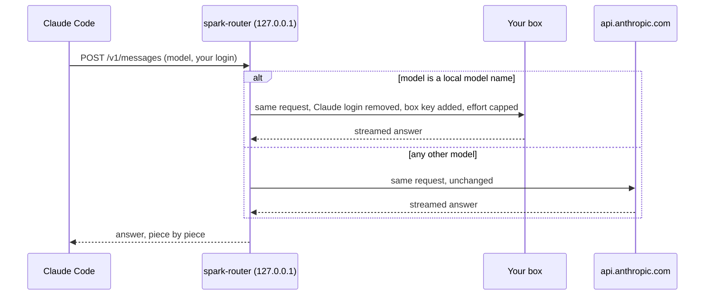

# How it works

This document explains how Local-Agents-CC and its components operate.

[Back to the README](../README.md)

## The parts

claude-agents is the launcher. It starts the router and Claude Code.
`spark-router` is the router. It directs requests to either a local model or Anthropic.

## Request flow

1. Claude Code sends a POST request to the router.
2. The router checks the model name in the request body.
3. If the model name is in `SPARK_ROUTER_LOCAL_MODELS`, the router sends the request to the local model server.
4. The local model server address is `SPARK_ROUTER_LOCAL_URL`.
5. If the model name is not in `SPARK_ROUTER_LOCAL_MODELS`, the router sends the request to `https://api.anthropic.com`.
6. The router sends the answer back to Claude Code piece by piece.

## Routing rule

The router only acts on POST requests to `/v1/messages` and paths under it.
The request must have a JSON content type. A JSON content type is any content type that is `application/json` or ends in `+json`.
The router reads the `model` field from the JSON body.
If the `model` name matches a name in `SPARK_ROUTER_LOCAL_MODELS`, the router sends the request to the local model server.
If the `model` is not in `SPARK_ROUTER_LOCAL_MODELS`, the router sends the request to `https://api.anthropic.com`.
The router keeps the path and query string the same.

## Headers

The router checks the Host header.
The Host header must be `127.0.0.1` or `localhost`.
This check prevents DNS-rebinding attacks. A DNS-rebinding attack is when a web page uses a different name to send requests to the router.
When sending a request to the local model server, the router removes the `Authorization`, `x-api-key`, and `Cookie` headers.
The router then adds `Authorization: Bearer <box key>`.
The router does not copy headers that describe one network hop. These headers are `Connection`, `Keep-Alive`, `Proxy-Connection`, `Transfer-Encoding`, `TE`, `Trailer`, `Upgrade`, `Host`, `Content-Length`, and `Expect`.
Anthropic requests keep every other header, including your `claude.ai` login.

## Reasoning effort cap

Some local models only accept `high`, `medium`, or `low` effort levels.
Claude Code sends its effort in an `output_config` field at the top level of the body.
The router changes `max` and `xhigh` to `high` in this field.
The router also changes `max` and `xhigh` to `high` in every `reasoning_effort` key, at any depth in the body (other clients send this key).
The router does not change an `effort` field inside the message history.
If no changes are made, the router sends the body bytes unchanged.
Anthropic requests never change, so Claude models keep the `max` value.

## Streaming and errors

The router sends each piece of the answer to Claude Code as it arrives.
The connection to the box or Anthropic must open within 15 seconds.
The router returns HTTP 502 if the box or Anthropic cannot be reached.
The router returns an Anthropic-style error body when it returns HTTP 502.
The router returns HTTP 413 if a request body is larger than 256 MiB.
The router returns HTTP 400 if the request URL cannot be parsed.

## Health check

A GET request to `http://127.0.0.1:8799/__spark-router/health` checks the system status.
The router checks the local model server with a GET request to `<box>/health`.
The router uses a 3-second limit for this check.
The router does not use a key for the health check.
This health check path is never forwarded.

## Logs

The router writes one line per request to its log files.
A log line includes the time, method, path (without query string), model, destination (BOX or anthropic), status, and time in milliseconds.
If the router changes the reasoning effort, it adds `effort=high(clamped)` to the log.
The router never logs headers, query strings, message text, or keys.
An example log line is: `14:02:11 info: POST /v1/messages model=local-model -> BOX 200 5321 ms`.

## The launcher

claude-agents performs these steps:

1. It reads the settings.
2. It asks the router for its health.
3. If the router does not answer, it starts `spark-router` in the background with no window.
4. The router keeps running until you sign out or restart.
5. If the local model server does not answer, it shows a warning or exits with an error if `--all-local` is used.
6. It starts Claude Code with session-only settings.
7. It removes `ANTHROPIC_API_KEY` and `ANTHROPIC_AUTH_TOKEN` so Claude Code uses your `claude.ai` login.
8. It sets `ANTHROPIC_BASE_URL` to the router.
9. It adds the "Spark Agents" model to the `/model` menu.
10. It sets `CLAUDE_CODE_MAX_CONTEXT_TOKENS` to 120000 unless you set it.
11. It passes all other arguments to Claude Code.
12. It returns the exit code of Claude Code.
13. It runs the settings guard when Claude Code ends.

## The settings guard

In `/model`, "Spark Agents" followed by `s` applies to this session only. Enter saves the local model as the default for all sessions, in Claude Code's settings file: `~/.claude/settings.json`, or `$CLAUDE_CONFIG_DIR/settings.json` when `CLAUDE_CONFIG_DIR` is set.
Plain `claude` cannot reach the local model. So when the session ends, the guard changes that one `"model"` line back to the default from before the session, or removes the line if there was no default, and prints a note. When the default before the session already was a local model name (an earlier session did not clean up), the guard removes the line, so Claude Code uses the default model for your plan.
Every other byte of the file stays the same. The guard writes a new file and swaps it in with one rename, so a crash cannot leave half a file.
If the guard cannot change the file, it prints a WARNING with the file path.

## The --all-local mode

With `--all-local`, no request uses your Claude plan. The launcher also sets:

- `ANTHROPIC_DEFAULT_OPUS_MODEL`, `ANTHROPIC_DEFAULT_SONNET_MODEL`, `ANTHROPIC_DEFAULT_HAIKU_MODEL` and `ANTHROPIC_DEFAULT_FABLE_MODEL` to the local model, so every model name goes to the box.
- `CLAUDE_CODE_SUBAGENT_MODEL` to the local model, and `CLAUDE_CODE_SUBAGENT_MODEL_FORCE=1`, so every agent uses it, also an agent whose file names another model.
- `CLAUDE_CODE_MAX_SUBAGENT_SPAWN_DEPTH=1`, so agents cannot start more agents.
- `BASH_DEFAULT_TIMEOUT_MS=600000`, a 10-minute limit for shell commands.

It starts Claude Code with `--model=<local model>` and `--disallowedTools=WebSearch`, because web search runs on Anthropic's servers. A `--model` that you give yourself comes later and wins.

## Safety rules

The router only listens on `127.0.0.1`.
The router only accepts requests where the Host header is `127.0.0.1` or `localhost`.
The router only routes JSON requests.
The Anthropic address is fixed in the code.
A request path cannot change the destination host. For example, a request for `/a/..//other.host/v1/messages` still goes to Anthropic.
The router never logs keys.
The router is not a sandbox. Any program that runs as your user can use the router and the box. Any such program can also read the key file.
